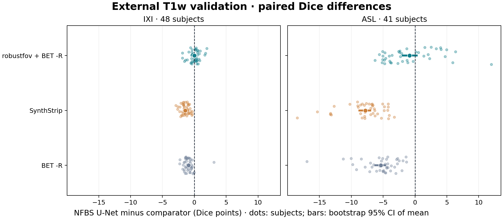

# Post-hoc crop map-back sensitivity

Recovered **54/54** primary cropped BET failures by exact voxel placement (13 required matching the ROI's float32 intensity representation). No extraction method was rerun, and the original predictions and scores were not changed.

| Cohort | Cropped BET Dice mean ± SD | Remaining failures | U-Net minus cropped BET, mean [95% CI] | Wins / ties / losses |
|---|---:|---:|---:|---:|
| IXI | 0.9558 ± 0.0096 | 0 | +0.02 [-0.21, +0.24] | 25 / 0 / 23 |
| ASL | 0.9036 ± 0.0509 | 0 | -0.85 [-2.05, +0.42] | 15 / 0 / 26 |
| Pooled | 0.9318 ± 0.0437 | 0 | -0.38 [-0.95, +0.22] | 40 / 0 / 49 |

Unrecovered cases: none.

The corrected masks had pooled median HD95 6.41 mm and one Dice below 0.8 (`asl_t1_144`, 0.7738). Across all 89 mapped crops, 23 retained less than 99% of the reference brain; the minimum retention was 82.05%. This is a separate effect of the fixed crop itself, even after the map-back issue is removed. The reference was used only to measure retention after mapping, not to change the crop or select a mask.

[Sensitivity protocol](../../../../docs/external_geometry_sensitivity.md) · [Evidence and hashes](evaluation_once.json) · [Primary analysis](../summary.md)
