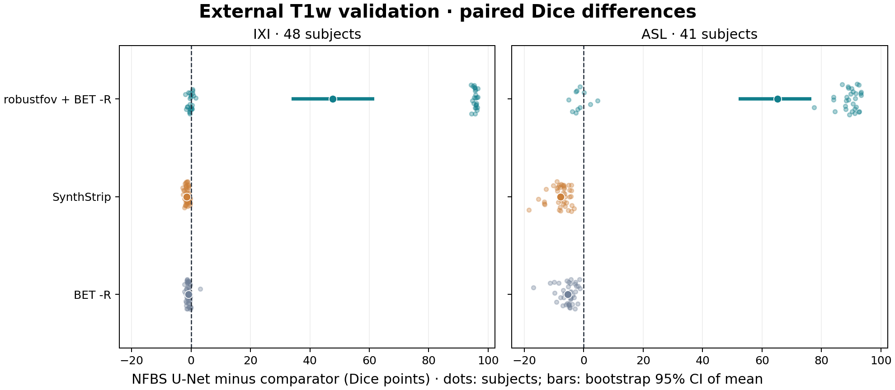

# External adult T1w validation: IXI and ASL

The NFBS checkpoint was applied unchanged to 89 independent adult T1w scans. The protocol and case selection were fixed before any external prediction. The original NFBS analysis remains unchanged.

**The NFBS advantage did not transfer to the stronger external comparisons.** The U-Net had lower pooled Dice than uncropped BET -R (−2.98 points, 95% CI [−3.43, −2.57]) and SynthStrip (−4.35 points [−4.84, −3.91]). SynthStrip had higher Dice in all 89 pairs. The U-Net scored 0.9560 on IXI and 0.8950 on ASL; its worst case was `asl_t1_152` (Dice 0.7761, HD95 25.83 mm). No U-Net, uncropped BET, or SynthStrip execution failed.

**The strict cropped BET contrast is dominated by map-back failures.** The pre-declared geometry checks rejected 54/89 outputs. The empty-mask policy gives a U-Net difference of +55.74 points, which reflects pipeline compatibility and should not be read as a segmentation advantage. A [separate post-hoc sensitivity](geometry_sensitivity/summary.md) remapped all 54 saved masks with exact voxel placement and whole-ROI intensity checks, without rerunning extraction. Cropped BET then reached 0.9318 mean Dice; the U-Net difference was **−0.38 points [−0.95, +0.22]**. This interval includes zero and is not an equivalence test.

## Absolute performance

| Cohort | Method | Dice mean ± SD | Median | Min | Dice <0.8 | Zero overlap | HD95 median [Q1, Q3] (mm) | Execution failures |
|---|---|---:|---:|---:|---:|---:|---:|---:|
| IXI (48) | NFBS U-Net | 0.9560 ± 0.0064 | 0.9573 | 0.9418 | 0 | 0 | 5.60 [5.29, 6.12] | 0 |
| IXI (48) | BET -R | 0.9652 ± 0.0103 | 0.9665 | 0.9110 | 0 | 0 | 4.69 [3.74, 5.28] | 0 |
| IXI (48) | robustfov + BET -R | 0.4791 ± 0.4842 | 0.4671 | 0.0000 | 24 | 24 | ∞ [5.27, ∞] | 24 |
| IXI (48) | SynthStrip | 0.9701 ± 0.0053 | 0.9705 | 0.9580 | 0 | 0 | 3.94 [3.74, 4.55] | 0 |
| ASL (41) | NFBS U-Net | 0.8950 ± 0.0343 | 0.9014 | 0.7761 | 1 | 0 | 18.71 [14.28, 25.83] | 0 |
| ASL (41) | BET -R | 0.9488 ± 0.0116 | 0.9503 | 0.9172 | 0 | 0 | 6.16 [5.10, 7.81] | 0 |
| ASL (41) | robustfov + BET -R | 0.2434 ± 0.4077 | 0.0000 | 0.0000 | 30 | 30 | ∞ [34.05, ∞] | 30 |
| ASL (41) | SynthStrip | 0.9731 ± 0.0054 | 0.9737 | 0.9592 | 0 | 0 | 3.74 [3.00, 4.12] | 0 |
| Pooled (89) | NFBS U-Net | 0.9279 ± 0.0386 | 0.9447 | 0.7761 | 1 | 0 | 7.17 [5.59, 18.47] | 0 |
| Pooled (89) | BET -R | 0.9577 ± 0.0136 | 0.9606 | 0.9110 | 0 | 0 | 5.27 [4.58, 6.29] | 0 |
| Pooled (89) | robustfov + BET -R | 0.3705 ± 0.4634 | 0.0000 | 0.0000 | 54 | 54 | ∞ [6.71, ∞] | 54 |
| Pooled (89) | SynthStrip | 0.9715 ± 0.0055 | 0.9724 | 0.9580 | 0 | 0 | 3.94 [3.38, 4.24] | 0 |

## Paired comparisons

Differences are U-Net minus comparator, in Dice points. Intervals are paired percentile bootstrap 95% intervals for the mean; the pooled analysis preserves the cohort sizes. The pre-declared primary contrast is pooled U-Net vs robustfov + BET -R.

| Cohort | Comparator | Mean difference [95% CI] | Median difference | U-Net wins / ties / losses |
|---|---|---:|---:|---:|
| IXI | robustfov + BET -R | +47.69 [+33.78, +61.62] | +47.93 | 33 / 0 / 15 |
| IXI | SynthStrip | -1.41 [-1.58, -1.24] | -1.42 | 0 / 0 / 48 |
| IXI | BET -R | -0.92 [-1.13, -0.68] | -1.00 | 1 / 0 / 47 |
| ASL | robustfov + BET -R | +65.16 [+52.14, +76.68] | +88.89 | 33 / 0 / 8 |
| ASL | SynthStrip | -7.80 [-8.87, -6.87] | -6.97 | 0 / 0 / 41 |
| ASL | BET -R | -5.38 [-6.37, -4.54] | -4.71 | 0 / 0 / 41 |
| Pooled | robustfov + BET -R | +55.74 [+46.29, +64.93] | +88.89 | 66 / 0 / 23 |
| Pooled | SynthStrip | -4.35 [-4.84, -3.91] | -2.30 | 0 / 0 / 89 |
| Pooled | BET -R | -2.98 [-3.43, -2.57] | -1.59 | 1 / 0 / 88 |

## Scope and reproducibility

These are adult T1w data from two external source cohorts, not evidence of performance in children, pathology, or other contrasts. The benchmark masks began as classical-method consensus and were manually refined. Differences from NFBS can reflect acquisition, cohort, and reference conventions. SynthStrip is assessed on its own publisher's held-out benchmark. Secondary contrasts are descriptive; intervals are not multiplicity adjusted. Empty predictions are retained with Dice 0 and HD95 ∞.

[Protocol](../../../docs/external_protocol.md) · [Source manifest](dataset.json) · [Case scores](per_subject.csv) · [Scoring lock](evaluation_once.json)
