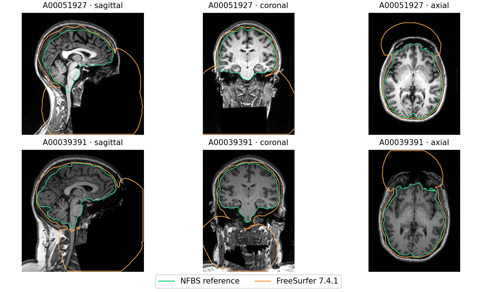
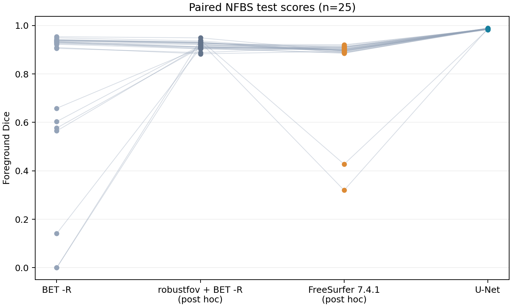
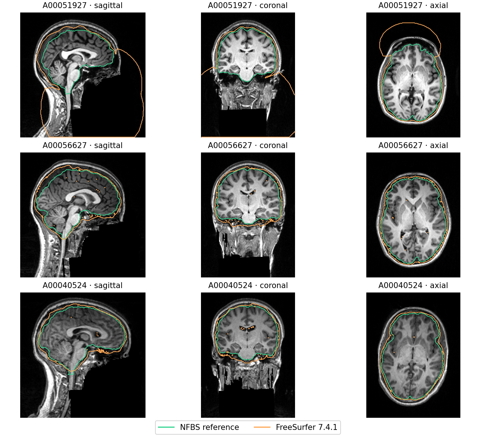

# Post-hoc supplementary baseline: FreeSurfer autorecon1

| Method | Dice mean ± SD | Median | Min | Dice < 0.8 | Zero overlap | HD95 median (mm) |
|---|---:|---:|---:|---:|---:|---:|
| U-Net (frozen) | 0.9863 ± 0.0018 | 0.9868 | 0.9820 | 0 | 0 | 1.41 |
| BET -R (frozen) | 0.7734 ± 0.3014 | 0.9301 | 0.0000 | 7 | 2 | 9.51 |
| robustfov + BET -R (post hoc) | 0.9178 ± 0.0154 | 0.9174 | 0.8830 | 0 | 0 | 10.72 |
| FreeSurfer 7.4.1 autorecon1 (post hoc) | 0.8591 ± 0.1472 | 0.8994 | 0.3199 | 2 | 0 | 8.25 |

| FreeSurfer minus comparator | Mean gain (points) | Median gain (points) | FreeSurfer wins | Ties |
|---|---:|---:|---:|---:|
| U-Net (frozen) | -12.73 | -8.69 | 0/25 | 0 |
| BET -R (frozen) | 8.56 | -2.62 | 8/25 | 0 |
| robustfov + BET -R (post hoc) | -5.87 | -1.41 | 3/25 | 0 |

Two-sided paired Wilcoxon p vs U-Net: **5.96046e-08** (descriptive and unadjusted).

The workflow was chosen after the original test results were available. All 25 cases were retained. Failed processing is scored as an empty mask (Dice 0 and HD95 infinity).

Processing failures: none.

Two masks had Dice below 0.8 despite successful commands and native-grid checks: **A00051927 (0.3199)** and **A00039391 (0.4274)**. Both overlays show extensive foreground outside the brain, including in the anterior and inferior zero-intensity regions of the original T1w. The masks contain 1,727,250 and 1,644,789 foreground voxels on native zero-intensity voxels, respectively. This diagnostic did not change either prediction or any score.

[Protocol](../../../docs/protocol.md#addendum-2026-11-10-post-hoc-freesurfer-baseline) · [Manifest](manifest.json) · [Subject scores](per_subject.csv)

